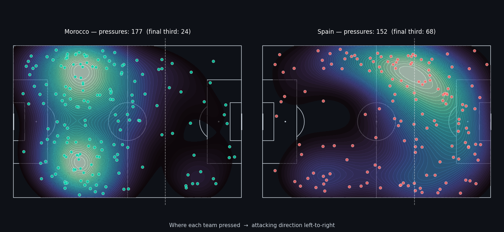
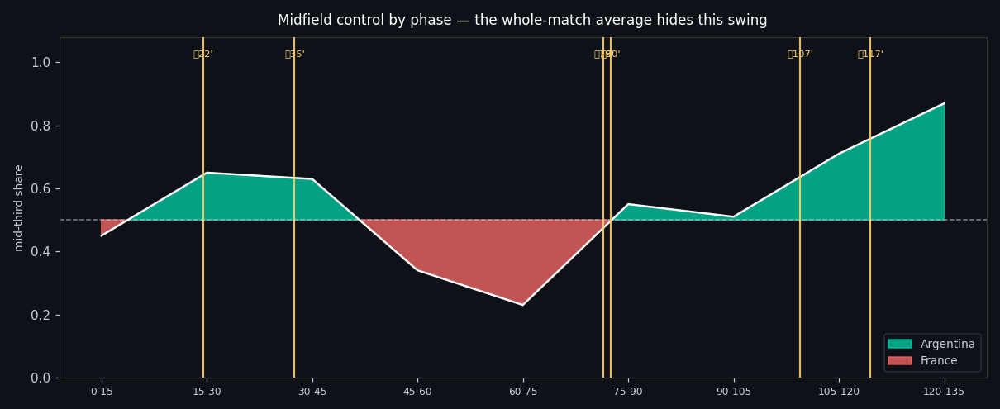

# World Cup 2022 Tactical Q&A

Ask a tactical question about any 2022 FIFA World Cup match in plain English, like *"Did Argentina press high in the semifinal?"* or *"Who controlled the midfield in the final?"*, and get an answer computed from real StatsBomb event and 360 data. The answer comes with the numbers, a pitch map, and a timeline.




## Why this exists

Language models are good at sounding like football analysts and bad at counting. Ask one about a specific match and it will invent a possession figure. This project splits the problem so that the language model never does the analysis:

- **Python computes every number** from StatsBomb's open event data.
- **A knowledge base encodes how to read those numbers**, including the situations where a popular metric lies.
- **The LLM only writes the final paragraph**, and it is constrained to the evidence it is handed.

## How it works

```
question
   │
   ▼
router.py ──── resolve_match  (deterministic lookup in the real StatsBomb matches table;
   │                           the LLM is never allowed to produce a match_id)
   │       └── select_concepts (retrieval over concept_kb.yaml)
   ▼
query_*.py ─── hardened metric computation on events / 360 freeze-frames,
   │           emitting numbers + reliability flags + a pre-computed "read"
   ▼
synthesis.py ─ Claude turns the evidence packet into a short analyst briefing
   │
   ▼
app.py ─────── Streamlit UI: answer, pressure map, midfield timeline
```

### Tactical concepts (`concept_kb.yaml`)

| Concept | Metric | Status |
|---|---|---|
| Pressing intensity | PPDA, high-press share, high pressures per 90 | ✅ Implemented |
| Controlling the midfield | Middle-third share over time, split by goal events | ✅ Implemented |
| Defensive line height | Back-line position from 360 freeze-frames, with an events-only fallback | ✅ Implemented |
| Build-up & ball progression | — | Defined in KB, query not built |
| Zone 14 threat | — | Defined in KB, query not built |

Each concept records its plain-language definition, the exact computation, and **interpretation rules**. Example: PPDA (opponent passes allowed per defensive action) breaks under lopsided possession. When the opponent barely has the ball, there are few passes to "allow," so PPDA shrinks and fakes an intense press. In Morocco 0–0 Spain, Spain's PPDA of 1.37 looks elite, but Spain had 79% of the ball. Above 65% possession the system marks PPDA unreliable and leads with high pressures instead (Spain 68, Morocco 24).

## Things that went wrong (and are now tested)

- **Phantom minutes.** StatsBomb's `minute` field includes the penalty shootout (period 5) and restarts at 45 in the second half. Naive 15-minute bins merged first-half stoppage time with the start of the second half. In the final, one "45–60" window mixed 55 events from one half with 106 from the other. `clock.py` bins by period instead.
- **Coordinate frames in 360 data.** Freeze-frame positions are in the acting team's frame, so measuring a team's back line means reading their players out of the *opponent's* events and inverting x. This was verified empirically from goalkeeper positions, not assumed.
- **Retrieval overfitting.** The keyword retriever scored 100% on questions written using the knowledge base's own vocabulary, but only 2 of 6 on real paraphrases. ("Sit back and absorb" matched build-up play because of the word "back.") That gap is why `retriever.py` has an embedding backend (`BAAI/bge-small-en-v1.5` via ONNX/fastembed) behind the same interface.

## Evaluation

`golden_set.yaml` holds 21 cases scored by **three separate graders**, so a failure points at the layer that broke:

1. **Routing:** right match and right concept? Refusing an ambiguous question counts as a *pass*; guessing counts as a fail.
2. **Computation:** do the numbers match externally verifiable facts (scorelines, goal minutes, possession skew)?
3. **Faithfulness:** does the written answer obey the guardrails instead of repeating the impressive-looking raw number? (Needs an API key.)

```bash
python eval_harness.py          # routing + computation
python eval_harness.py --live   # adds the faithfulness grader
```

## Run it

```bash
git clone https://github.com/VKMYTH/world-cup-tactical-analytics.git
cd world-cup-tactical-analytics
python -m venv .venv && source .venv/bin/activate
pip install -r requirements.txt

cp .env.example .env            # then add your Anthropic API key
streamlit run app.py
```

Without an API key, the app still runs. It shows the computed evidence and charts and skips the written answer. `python pipeline.py` runs end to end in dry-run mode, which prints the exact prompt that would be sent.

## Data

[StatsBomb Open Data](https://github.com/statsbomb/open-data) for the 2022 FIFA World Cup (competition 43, season 106), including 360 freeze-frames, loaded through `statsbombpy`. No data is stored in this repo; it downloads on first run.

## Built with

Python · pandas · statsbombpy · mplsoccer · matplotlib · Streamlit · fastembed · Anthropic API
